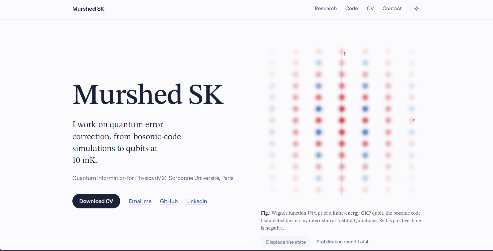

# Murshed SK

**Quantum information physicist · Quantum error correction** 
M2 Quantum Information for Physics, Sorbonne Université, Paris

🌐 **[murshedsk.github.io](https://murshedsk.github.io)** &nbsp;|&nbsp; 📫 [murshedsk135@gmail.com](mailto:murshedsk135@gmail.com) &nbsp;|&nbsp; 💼 [LinkedIn](https://www.linkedin.com/in/murshed-sk/)

---

## About me

I work on quantum error correction, from bosonic-code simulations to qubits at 10 mK. My master's research has moved between theory and the lab: security bounds for continuous-variable quantum position verification at LIG Grenoble, then autonomous stabilization of GKP qubits at Institut Quantique in Sherbrooke, where I also worked on a dilution refrigerator, a 3-qubit transmon processor and real-time FPGA control.

I enjoy the whole chain: deriving a bound, writing the simulation, and then running the experiment that tests it.

🎯 **I'm open to PhD positions and research roles in fault-tolerant quantum computing.**

## Research

**Comparing QEC codes on different types of circuits** · *with students from UCLA* · Oct 2026 – now 
Benchmarking the rotated surface code (MWPM) against the [[144, 12, 12]] bivariate bicycle code (BP-OSD) on memory, Clifford and non-Clifford circuits, using Stim and Sinter for fault-tolerant circuit and magic-state simulations.

**Autonomous stabilization of Gottesman–Kitaev–Preskill qubits** · *M2 internship, Institut Quantique, Université de Sherbrooke* · Mar – Sep 2026 
Supervisor: Benjamin Brock. Simulated finite-energy GKP codes and Small-Big-Small (sBs) stabilization in QuTiP; ran CW spectroscopy on a 3-qubit transmon processor in a dilution refrigerator; programmed low-latency feedback on Quantum Machines OPX+ and QICK RFSoC. 
→ [Simulation code](https://github.com/MurshedSK/Bosonic_QEC-GKP-Codes-and-sBs-Protocol) · [Lab scripts](https://github.com/MurshedSK/cQED-Cryogenic-and-Qubit-Characterization)

**Quantum error correction with squeezed cat states** · *IKAA Summer School, IISER* · Aug 2025 
Studied squeezed cat codes against photon loss and dephasing, using the Knill–Laflamme conditions and channel fidelities.

**A routing protocol for continuous-variable quantum position verification** · *M1 internship, LIG Grenoble (UGA, CNRS)* · May – Jul 2025 
Supervisor: Andreas Bluhm. Designed a routing protocol with Gaussian-modulated coherent states and derived security bounds against intercept-and-resend and replacement attacks.

**Error mitigation with zero-noise extrapolation** · Jun – Aug 2024 
Built a scalable circuit simulator with Trotter evolution and applied polynomial and exponential ZNE under Pauli–Lindblad noise.

## Selected projects

| Project | What it is |
|---|---|
| [GKP codes and the sBs protocol](https://github.com/MurshedSK/Bosonic_QEC-GKP-Codes-and-sBs-Protocol) | QuTiP simulations of finite-energy GKP states and autonomous stabilization |
| [cQED cryogenic and qubit characterization](https://github.com/MurshedSK/cQED-Cryogenic-and-Qubit-Characterization) | LNA characterization, VNA spectroscopy, pulsed T1, Rabi and Ramsey control |
| [Quantum imaging lab](https://github.com/MurshedSK/Quantum-Imaging-Lab) | SPDC photon correlations with a SPAD camera, testing the Heisenberg inequality |
| [BB84 quantum key distribution](https://github.com/MurshedSK/QKD_BB84_Practical-Session) | Practical BB84 implementation with simulation results |
| [VQE for H₂](https://github.com/MurshedSK/Numerical-Project-VQE) | Ground-state energy of molecular hydrogen with the Classiq SDK |
| [Qiskit Fall Fest 2025](https://github.com/MurshedSK/qiskit-hackathon---qiskit_fall_fest_2025) | Hackathon submission |

## In the lab

- **Cryogenics and RF:** dilution refrigerator down to 10 mK, CW transmon spectroscopy, dispersive-shift measurements, PyHegel automation
- **FPGA control:** feedback loops and active reset on OPX+ (QUA) and Xilinx RFSoC (QICK)
- **Quantum optics:** free-space alignment, single-photon detection, Bell tests, BB84 polarization encoding
- **Lasers:** built a 1064 nm diode-pumped Nd:YAG laser; Doppler velocimetry with a Michelson interferometer

## Tools

**Quantum:** QuTiP · Stim · Sinter · Qiskit · PennyLane · Cirq · pytket · QUA

**Programming:** Python (NumPy, SciPy) · C/C++ · Julia · MATLAB · Fortran · Bash · Git · LaTeX

**Simulation and instruments:** COMSOL Multiphysics · LabVIEW · PyHegel · SMD soldering

## Honours and schools

- 🏅 **Womanium Global Quantum Scholarship**, 2023, 2024, 2025
- 🏅 **SMARTS-UP Scholarship**, Université Paris Cité, 2024
- 🏅 **University top scorer**, IAPT National Graduate Physics Examination, 2023
- 🎓 AlgoLab Summer School: Towards FTQC, Institut Quantique (2026) · IQM Quantum Summer School (2025, 2026) · IKAA QEC School, IISER (2025) · Qiskit Global Summer School, IBM (2023 – 2026)
- 💻 MIT iQuHACK quantum hackathon, 2025 and 2026

## Education

- **M2 Quantum Information for Physics**, Sorbonne Université, 2025 – 2026
- **M1 Paris Physics Master**, Université Paris Cité and Sorbonne Université, 2024 – 2025
- **B.Sc. (Honours) Physics**, Aligarh Muslim University, 2020 – 2023

## Languages

English (fluent) · Bengali (native) · Hindi (fluent) · French (learning, A1)

---

This repository holds the source of [murshedsk.github.io](https://murshedsk.github.io): plain HTML and CSS in `index.html`, hosted on GitHub Pages. The figure on the homepage is the Wigner function of a finite-energy GKP qubit. © 2026 Murshed SK.
